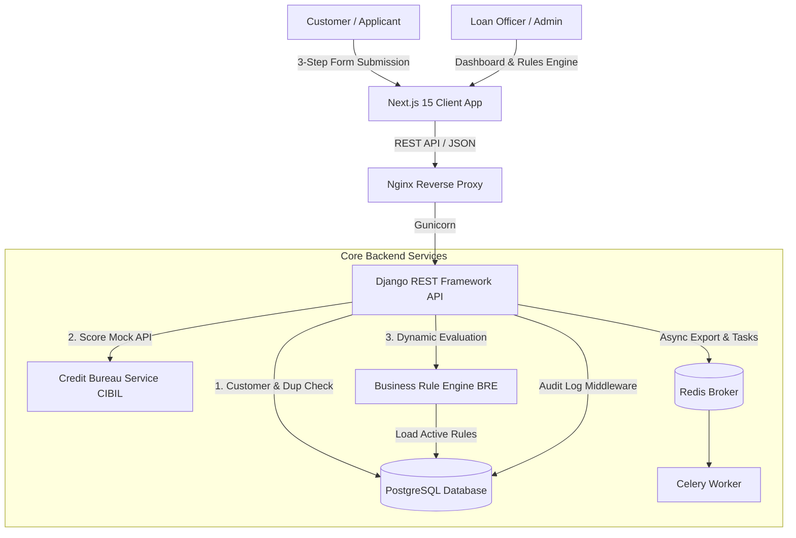
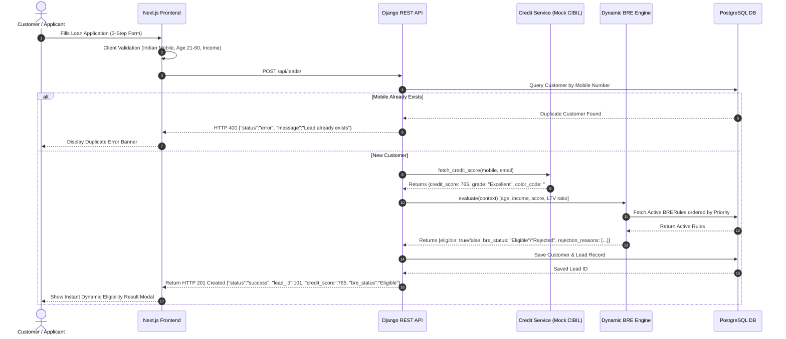

# LoanPilot Technical Architecture & Comprehensive Documentation

## 1. Executive Overview & System Architecture

LoanPilot is a full-stack digital loan eligibility evaluation platform that automates lead capture, credit bureau scoring, Business Rule Engine (BRE) evaluation, and administrative reporting.



---

## 2. Comprehensive Workflow & Data Flow



---

## 3. Business Rule Engine (BRE) Implementation

The BRE dynamically evaluates loan applications against prioritized rules stored in the database without requiring code redeployment.

### 3.1 Rule Schema Definition
Each rule consists of:
- `rule_name`: Unique descriptor (e.g. `MIN_INCOME_CHECK`).
- `field`: Target context attribute (`monthly_income`, `credit_score`, `age`, `loan_to_value_ratio`).
- `operator`: Comparison operator (`>=`, `<=`, `>`, `<`, `==`, `!=`).
- `value`: Threshold value (e.g. `20000`, `650`).
- `error_message`: Customer-facing rejection reason.
- `priority`: Order of evaluation (lower number = higher priority).
- `is_active`: Toggle flag for instant rule activation/deactivation.

### 3.2 BRE Core Code Snippet (`apps/bre/engine.py`)

```python
class BREEngine:
    @staticmethod
    def evaluate(context: dict) -> dict:
        """
        Evaluates context dictionary against active BRERules in priority order.
        """
        active_rules = BRERule.objects.filter(is_active=True).order_by('priority')
        rejection_reasons = []
        rule_evaluations = []
        is_eligible = True

        for rule in active_rules:
            field_val = context.get(rule.field)
            passed = True
            
            if field_val is None:
                passed = False
            else:
                try:
                    val = float(rule.value)
                    target = float(field_val)
                    if rule.operator == '>=': passed = target >= val
                    elif rule.operator == '<=': passed = target <= val
                    elif rule.operator == '>': passed = target > val
                    elif rule.operator == '<': passed = target < val
                    elif rule.operator == '==': passed = target == val
                    elif rule.operator == '!=': passed = target != val
                except ValueError:
                    passed = str(field_val).lower() == str(rule.value).lower()

            rule_evaluations.append({
                "rule_name": rule.rule_name,
                "field": rule.field,
                "passed": passed
            })

            if not passed:
                is_eligible = False
                rejection_reasons.append(rule.error_message)

        return {
            "eligible": is_eligible,
            "bre_status": "Eligible" if is_eligible else "Rejected",
            "rejection_reasons": rejection_reasons,
            "rule_evaluations": rule_evaluations
        }
```

### 3.3 Default Seeded BRE Rules

| Priority | Rule Name | Field | Operator | Value | Rejection Message |
| :--- | :--- | :--- | :--- | :--- | :--- |
| 1 | `MIN_AGE_CHECK` | `age` | `>=` | `21` | Applicant age must be at least 21 years old |
| 2 | `MAX_AGE_CHECK` | `age` | `<=` | `60` | Applicant age must not exceed 60 years |
| 3 | `MIN_INCOME_CHECK` | `monthly_income` | `>=` | `20000` | Monthly income must be at least ₹20,000 |
| 4 | `MIN_CIBIL_SCORE` | `credit_score` | `>=` | `650` | CIBIL credit score is below the minimum required threshold of 650 |
| 5 | `MAX_LTV_RATIO` | `loan_to_value_ratio` | `<=` | `85` | Loan-to-Value (LTV) ratio exceeds maximum permissible limit of 85% |

---

## 4. Credit Score Bureau Integration

The platform integrates the **Decentro Credit Bureau API** (`apps/credit/services.py`) to fetch official CIBIL credit report summaries:

- **Live Staging Endpoint**: `https://in.staging.decentro.tech/v2/financial_services/credit_bureau/credit_report/summary`
- **Method**: `POST`
- **Headers**: `client_id`, `client_secret`, `module_secret`, `Content-Type: application/json`
- **Payload Schema**:
  ```json
  {
    "mobile_number": "9876543210",
    "name": "Rajesh Kumar",
    "email_address": "rajesh@example.com",
    "inquiry_purpose": "INQUIRE_CREDIT_REPORT",
    "consent": true,
    "consent_purpose": "Loan Eligibility Evaluation"
  }
  ```

### Bureau Scoring Grade Matrix

| Credit Score Range | Grade | Badge Color | Status |
| :--- | :--- | :--- | :--- |
| **750 – 900** | Excellent | `#22C55E` (Green) | High Approval Likelihood |
| **700 – 749** | Good | `#3B82F6` (Blue) | Standard Approval |
| **650 – 699** | Fair | `#F59E0B` (Amber) | Conditional Approval |
| **Below 650** | Poor | `#EF4444` (Red) | High Risk / BRE Rejection |

---

## 5. SQL Database Dump (DDL Schema & Initial Seed Data)

```sql
-- PostgreSQL / SQLite Database Schema DDL for LoanPilot Platform

-- 1. Customers Table
CREATE TABLE IF NOT EXISTS customers_customer (
    id SERIAL PRIMARY KEY,
    full_name VARCHAR(150) NOT NULL,
    mobile_number VARCHAR(10) UNIQUE NOT NULL,
    email VARCHAR(254) NOT NULL,
    date_of_birth DATE NOT NULL,
    city VARCHAR(100) NOT NULL,
    state VARCHAR(100) NOT NULL,
    pincode VARCHAR(6) NOT NULL,
    aadhaar_number VARCHAR(12),
    pan_number VARCHAR(10),
    consent_accepted BOOLEAN DEFAULT TRUE NOT NULL,
    created_at TIMESTAMP WITH TIME ZONE DEFAULT CURRENT_TIMESTAMP NOT NULL
);

CREATE INDEX idx_customer_mobile ON customers_customer(mobile_number);

-- 2. BRE Rules Table
CREATE TABLE IF NOT EXISTS bre_brerule (
    id SERIAL PRIMARY KEY,
    rule_name VARCHAR(100) UNIQUE NOT NULL,
    field VARCHAR(50) NOT NULL,
    operator VARCHAR(10) NOT NULL,
    value VARCHAR(100) NOT NULL,
    error_message TEXT NOT NULL,
    priority INT DEFAULT 1 NOT NULL,
    is_active BOOLEAN DEFAULT TRUE NOT NULL,
    created_at TIMESTAMP WITH TIME ZONE DEFAULT CURRENT_TIMESTAMP NOT NULL,
    updated_at TIMESTAMP WITH TIME ZONE DEFAULT CURRENT_TIMESTAMP NOT NULL
);

-- 3. Leads Table
CREATE TABLE IF NOT EXISTS leads_lead (
    id SERIAL PRIMARY KEY,
    customer_id INT REFERENCES customers_customer(id) ON DELETE CASCADE,
    loan_type VARCHAR(50) NOT NULL,
    employment_type VARCHAR(50) NOT NULL,
    monthly_income NUMERIC(12, 2) NOT NULL,
    loan_amount NUMERIC(12, 2) NOT NULL,
    property_value NUMERIC(12, 2) DEFAULT 0.00 NOT NULL,
    loan_to_value_ratio NUMERIC(5, 2) DEFAULT 0.00 NOT NULL,
    credit_score INT NOT NULL,
    credit_grade VARCHAR(20) NOT NULL,
    credit_color_code VARCHAR(10) NOT NULL,
    bre_status VARCHAR(20) NOT NULL,
    rejection_reasons JSONB DEFAULT '[]'::jsonb,
    rule_evaluations JSONB DEFAULT '[]'::jsonb,
    assigned_to_id INT,
    is_deleted BOOLEAN DEFAULT FALSE NOT NULL,
    created_at TIMESTAMP WITH TIME ZONE DEFAULT CURRENT_TIMESTAMP NOT NULL,
    updated_at TIMESTAMP WITH TIME ZONE DEFAULT CURRENT_TIMESTAMP NOT NULL
);

CREATE INDEX idx_lead_status ON leads_lead(bre_status);
CREATE INDEX idx_lead_created ON leads_lead(created_at);

-- 4. Audit Log Table
CREATE TABLE IF NOT EXISTS audit_auditlog (
    id SERIAL PRIMARY KEY,
    user VARCHAR(150) DEFAULT 'Anonymous' NOT NULL,
    action VARCHAR(50) NOT NULL,
    module VARCHAR(50) NOT NULL,
    path VARCHAR(255) NOT NULL,
    ip_address VARCHAR(45) NOT NULL,
    status_code INT NOT NULL,
    timestamp TIMESTAMP WITH TIME ZONE DEFAULT CURRENT_TIMESTAMP NOT NULL
);

-- Initial Seed Insert for Default BRE Rules
INSERT INTO bre_brerule (rule_name, field, operator, value, error_message, priority, is_active)
VALUES 
('MIN_AGE_CHECK', 'age', '>=', '21', 'Applicant age must be at least 21 years old', 1, true),
('MAX_AGE_CHECK', 'age', '<=', '60', 'Applicant age must not exceed 60 years', 2, true),
('MIN_INCOME_CHECK', 'monthly_income', '>=', '20000', 'Monthly income must be at least ₹20,000', 3, true),
('MIN_CIBIL_SCORE', 'credit_score', '>=', '650', 'CIBIL credit score is below the minimum required threshold of 650', 4, true),
('MAX_LTV_RATIO', 'loan_to_value_ratio', '<=', '85', 'Loan-to-Value (LTV) ratio exceeds maximum permissible limit of 85%', 5, true)
ON CONFLICT (rule_name) DO NOTHING;
```

---

## 6. README.md with Setup Instructions

```markdown
# LoanPilot - Smart Loan Eligibility & Lead Management Engine

LoanPilot is a full-stack digital platform designed for instant loan eligibility checks, dynamic BRE evaluation, and automated lead processing for Banks and NBFCs.

## 🚀 Quick Setup Instructions

### Prerequisites
- **Python**: 3.11+
- **Node.js**: 20+
- **Docker**: Docker & Docker Compose (Optional)

---

### Option 1: Running Locally (Development)

#### 1. Backend Setup (Django REST Framework)
```bash
cd backend
python -m venv venv
# On Windows: venv\Scripts\activate | On Linux/macOS: source venv/bin/activate
pip install -r requirements.txt
python manage.py makemigrations
python manage.py migrate
python manage.py seed_bre_rules
python manage.py runserver 0.0.0.0:8000
```
- API Base URL: `http://localhost:8000/api/`
- Swagger Documentation: `http://localhost:8000/api/schema/swagger-ui/`

#### 2. Frontend Setup (Next.js 15 App Router)
```bash
cd frontend
npm install
npm run dev
```
- Web Application URL: `http://localhost:3001` or `http://localhost:3000`

---

### Option 2: Running with Docker Compose (One-Command)

```bash
docker compose up -d --build
```
This automatically boots PostgreSQL, Redis, Django API, Celery Worker, Next.js Frontend, and Nginx.
```

---

## 7. Postman Collection JSON

```json
{
  "info": {
    "name": "LoanPilot API Collection",
    "description": "Complete production endpoints for Lead Capture, Dynamic BRE, Admin Analytics, and JWT Authentication",
    "schema": "https://schema.getpostman.com/json/collection/v2.1.0/collection.json"
  },
  "item": [
    {
      "name": "Authentication",
      "item": [
        {
          "name": "Login (JWT Token)",
          "request": {
            "method": "POST",
            "header": [{ "key": "Content-Type", "value": "application/json" }],
            "body": {
              "mode": "raw",
              "raw": "{\n  \"username\": \"admin\",\n  \"password\": \"admin123\"\n}"
            },
            "url": { "raw": "{{baseUrl}}/api/auth/login/", "host": ["{{baseUrl}}"], "path": ["api", "auth", "login", ""] }
          }
        }
      ]
    },
    {
      "name": "Leads",
      "item": [
        {
          "name": "Submit Customer Lead",
          "request": {
            "method": "POST",
            "header": [{ "key": "Content-Type", "value": "application/json" }],
            "body": {
              "mode": "raw",
              "raw": "{\n  \"full_name\": \"Rajesh Kumar\",\n  \"mobile_number\": \"9876543210\",\n  \"email\": \"rajesh@example.com\",\n  \"date_of_birth\": \"1992-05-15\",\n  \"city\": \"Mumbai\",\n  \"state\": \"Maharashtra\",\n  \"pincode\": \"400001\",\n  \"consent_accepted\": true,\n  \"loan_type\": \"Home Loan\",\n  \"employment_type\": \"Salaried\",\n  \"monthly_income\": 60000,\n  \"loan_amount\": 2500000,\n  \"property_value\": 4000000\n}"
            },
            "url": { "raw": "{{baseUrl}}/api/leads/", "host": ["{{baseUrl}}"], "path": ["api", "leads", ""] }
          }
        },
        {
          "name": "Get All Leads (Admin)",
          "request": {
            "method": "GET",
            "header": [{ "key": "Authorization", "value": "Bearer {{accessToken}}" }],
            "url": { "raw": "{{baseUrl}}/api/leads/", "host": ["{{baseUrl}}"], "path": ["api", "leads", ""] }
          }
        }
      ]
    },
    {
      "name": "BRE Engine",
      "item": [
        {
          "name": "List BRE Rules",
          "request": {
            "method": "GET",
            "header": [{ "key": "Authorization", "value": "Bearer {{accessToken}}" }],
            "url": { "raw": "{{baseUrl}}/api/bre-rules/", "host": ["{{baseUrl}}"], "path": ["api", "bre-rules", ""] }
          }
        },
        {
          "name": "Test BRE Sandbox",
          "request": {
            "method": "POST",
            "header": [
              { "key": "Content-Type", "value": "application/json" },
              { "key": "Authorization", "value": "Bearer {{accessToken}}" }
            ],
            "body": {
              "mode": "raw",
              "raw": "{\n  \"age\": 30,\n  \"monthly_income\": 50000,\n  \"credit_score\": 750,\n  \"loan_amount\": 2500000,\n  \"property_value\": 4000000\n}"
            },
            "url": { "raw": "{{baseUrl}}/api/bre-rules/test/", "host": ["{{baseUrl}}"], "path": ["api", "bre-rules", "test", ""] }
          }
        }
      ]
    }
  ]
}
```
